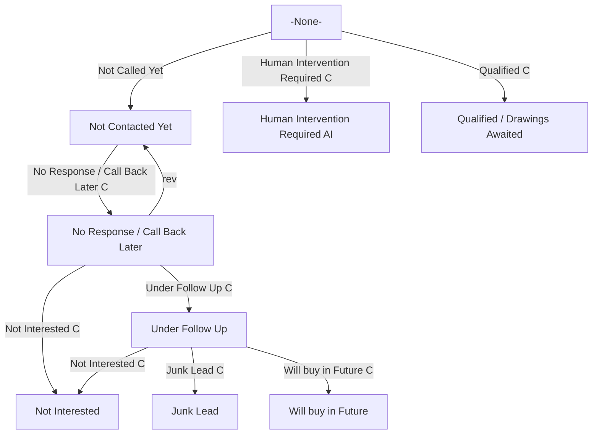
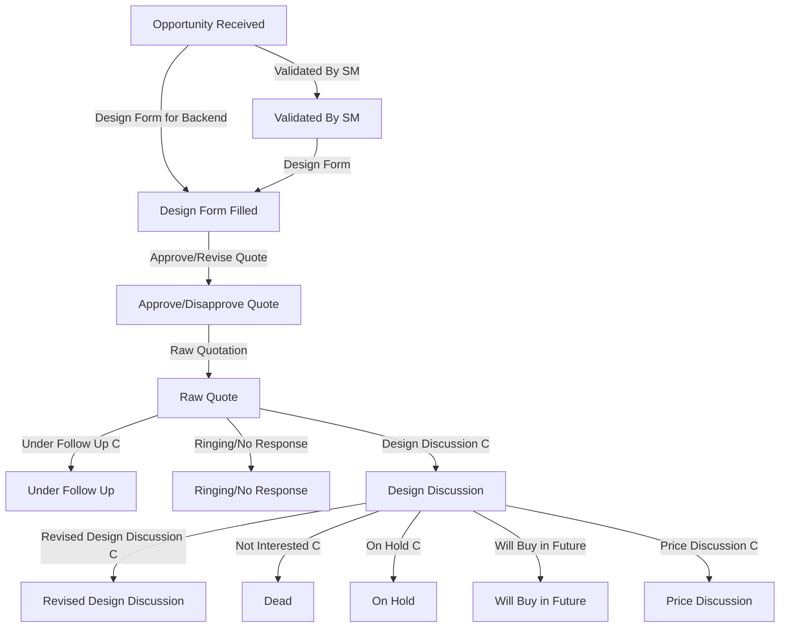
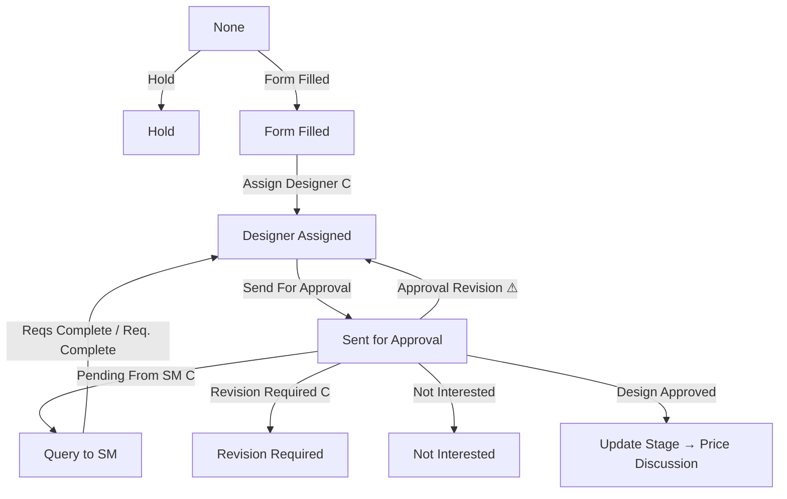
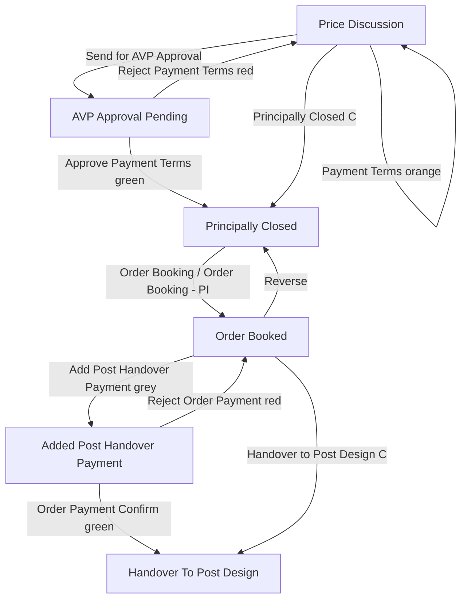
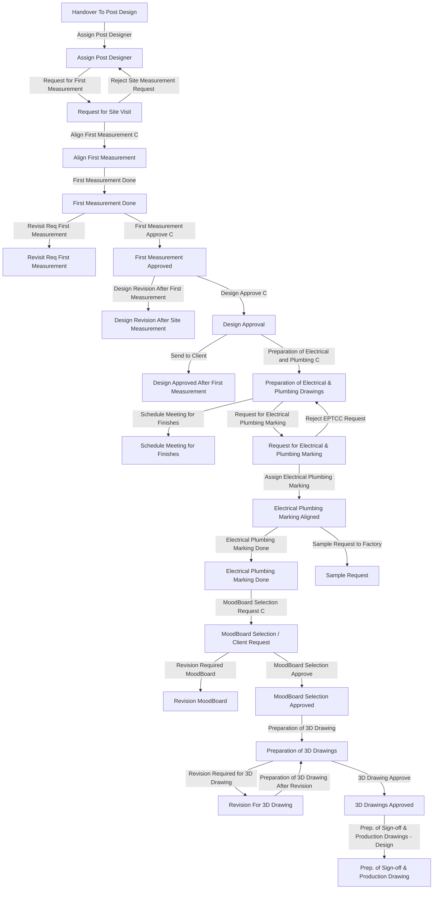
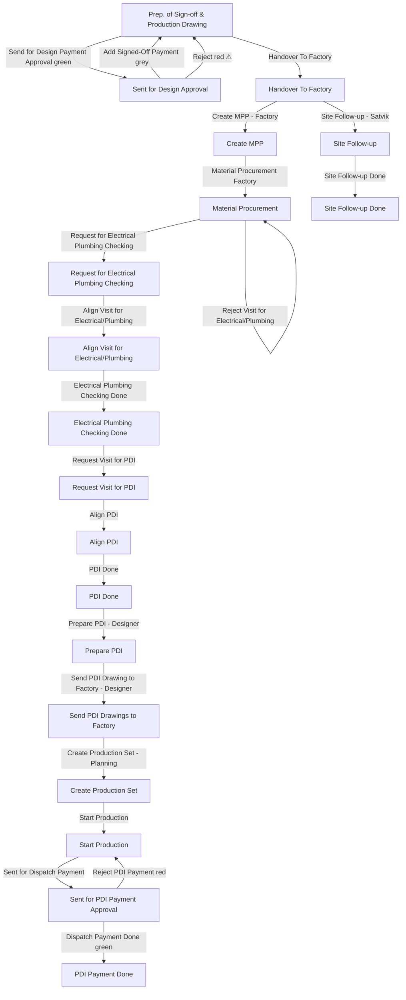

# Pre-Sales → Factory: the Zoho CRM blueprint system

A teaching guide to how a Magppie customer moves through Zoho CRM, from the first lead call until the order is in production at the factory. It is built from the blueprints in **Setup → Process Management → Blueprint** (org `60046349006`).

> **Source and confidence.** This guide was transcribed from screenshots of four blueprints on 2026-10-23. Each screenshot shows the states and the transitions between them. It does **not** show what is inside a transition: who may click it, its criteria, mandatory fields, attachments, or automations. Those details are marked **"Confirm in Zoho"**. Labels that were cut off in the screenshots are written in full where the meaning was obvious and marked ⚠ where it was not.

---

## 1. How to read a blueprint

| Term | In the Zoho diagram | What it means for staff |
|---|---|---|
| **State** | Dark box (e.g. `Order Booked`) | Where the record is right now. It is stored in the blueprint field (Lead Status / Status / Stage). |
| **Transition** | Blue parallelogram (e.g. `Assign Post Designer`) | The button the user clicks on the record to move it to the next state. Only the transitions leaving the current state are shown. |
| **Common transition** | Parallelogram with a **C** badge | A button available from **several** states, not just the one it is drawn from (e.g. `Not Interested`, `On Hold`). |
| **Green transition** | Green parallelogram | An approval or "money received" step (e.g. `Approve Payment Terms`, `Order Payment Confirm`). |
| **Red transition** | Red parallelogram | A rejection that sends the record back (e.g. `Reject Payment Terms`, `Reject PDI Payment`). |
| **Grey transition** | Grey parallelogram | Adds a payment entry or booking detail (e.g. `Add Post Handover Payment`, `Order Booking - PI`). |
| **Yellow / orange** | Yellow or orange parallelogram | An escalation or alternate path (e.g. `Send for AVP Approval`, `Payment Terms`). |
| **Back-arrow / `rev`** | A line going back up | A reverse or revision loop. The record returns to an earlier state. |

**Golden rule for staff:** never edit the stage field by hand. Always use the transition button. That is how the system records who moved the record and when, and how the dashboards (Monitoring Review) calculate turnaround.

---

## 2. The blueprints in scope

| # | Blueprint | Module | Field | Status in Zoho | Covers |
|---|---|---|---|---|---|
| A | **Lead nurturing process** | Raw Leads | Lead Status | On | First contact → qualified |
| B | **Opportunity Stage** | Qualified Leads | Status | On | Design form → quote → booking → post design → factory → handover |
| C | **Order Stages** | Orders (API: `Deals`) | Stage | On | The order-side copy of the same journey |
| D | **Post Design** | Orders | Stage | **Off** | A short hub version of the post-design steps |

Out of scope here: Task Process Management, the complaint blueprints (AMS/Complaints), and the Installation Visit Flow.

> ⚠ **B and C repeat the same long pipeline in two modules.** Wherever they differ, both versions are shown below. Ask the CRM admin which one is the source of truth for each team.

---

## 3. End-to-end map (one picture)

```mermaid
flowchart LR
  subgraph PS[1 Pre-Sales / Telecalling]
    L1[New lead] --> L2[Qualified / Drawings Awaited]
  end
  subgraph SA[2 Sales + Pre-Design]
    O1[Validated by SM] --> O2[Design Form Filled] --> O3[Raw Quote] --> O4[Design Discussion] --> O5[Price Discussion]
  end
  subgraph AP[3 Approvals + Accounts]
    O5 --> A1[AVP Approval Pending] --> A2[Principally Closed] --> A3[Order Booked] --> A4[Handover to Post Design]
  end
  subgraph PD[4 Post Design]
    P1[Assign Post Designer] --> P2[First Measurement] --> P3[Design Approval] --> P4[Electrical & Plumbing] --> P5[MoodBoard & 3D] --> P6[Sign-off & Production Drawing]
  end
  subgraph FA[5 Factory]
    F1[Handover to Factory] --> F2[Create MPP] --> F3[Material Procurement] --> F4[PDI] --> F5[Production Set] --> F6[Start Production]
  end
  L2 --> O1
  A4 --> P1
  P6 --> F1
```



**Department hand-off points**

| From → To | The record is handed over when it reaches | Moved by |
|---|---|---|
| Pre-Sales → Sales | `Qualified/Drawings Awaited` (Raw Leads) | Telecaller |
| Sales → Approvals | `Price Discussion` → `Send for AVP Approval` | Sales Manager (SM) |
| Accounts → Post Design | `Order Booked` → `Handover to Post Design` | Accounts / SM ⚠ Confirm in Zoho |
| Post Design → Factory | `Pre. of Sign-off & Production Drawing` → `Handover To Factory` | Post Designer |
| Designer → Planning | `Send PDI Drawing to Factory` → `Create Production Set - Planning` | Planning team |

---

## 4. Department 1: Pre-Sales (Blueprint A, Lead nurturing process)

**Module:** Raw Leads · **Field:** Lead Status · **Owner:** pre-sales / telecalling team

### 4.1 Flow



### 4.2 Logic

| Current state | Button | Next state | When to use it |
|---|---|---|---|
| -None- (new lead) | Not Called Yet | Not Contacted Yet | The lead has landed and is in the calling queue. |
| -None- | Human Intervention Required **(C)** | Human Intervention Required (AI) | The AI caller/bot could not handle the lead and a person must take over. |
| -None- / any | Qualified **(C)** | **Qualified / Drawings Awaited** | Genuine requirement confirmed and the customer will share drawings. **Exit to Sales.** |
| Not Contacted Yet | No Response / Call Back Later **(C)** | No Response / Call Back Later | The call was not answered or the customer asked for a callback. |
| No Response / Call Back Later | rev | Not Contacted Yet | Put the lead back in the fresh calling queue. |
| No Response / Call Back Later | Under Follow Up **(C)** | Under Follow Up | The customer was reached and is interested but not ready. |
| No Response / Under Follow Up | Not Interested **(C)** | Not Interested | The customer declined. *Terminal.* |
| Under Follow Up | Junk Lead **(C)** | Junk Lead | Fake, duplicate or wrong number. *Terminal.* |
| Under Follow Up | Will buy in Future **(C)** | Will buy in Future | A real customer with a later timeline. Use it for nurture campaigns. |

**Terminal states:** Not Interested, Junk Lead, Will buy in Future, and Qualified (which leaves this blueprint).
**Teaching point:** every transition except `Not Called Yet` and `rev` is common. A telecaller can therefore qualify, junk or drop a lead from almost any calling state.

### 4.3 Wireframe: Raw Lead record (telecaller view)

```
┌──────────────────────────────────────────────────────────────────────┐
│ Raw Lead: <Customer name>            Lead Status: No Response / CBL  │
├──────────────────────────────────────────────────────────────────────┤
│ Blueprint ▸  [Under Follow Up] [Not Interested] [Qualified] [rev]    │
├───────────────────────────────┬──────────────────────────────────────┤
│ Phone / Email / City / Source │ Call log & notes timeline            │
│ State (State1)                │  • 23 Oct 11:02 No answer            │
│ Requirement (kitchen/wardrobe)│  • 22 Oct 17:40 Asked to call back   │
│ Next callback date            │                                      │
└───────────────────────────────┴──────────────────────────────────────┘
  Clicking a button opens the transition form (mandatory fields,
  e.g. remarks / callback date). Confirm in Zoho.
```

---

## 5. Department 2: Sales and Pre-Design (Blueprint B, start of Opportunity Stage)

**Module:** Qualified Leads · **Field:** Status · **Owners:** Sales Manager (SM), pre-sales designer

### 5.1 Flow (Blueprint B)



⚠ The exact wiring between Opportunity Received, Validated By SM and Design Form Filled is dense in the screenshot (it includes `reverse` and `Order…` links). Confirm in Zoho.

### 5.2 Flow (Blueprint C, Orders version of the same stretch)



### 5.3 Logic

| Step | What happens | Who | Done when |
|---|---|---|---|
| Validate | SM checks the qualified lead (budget, site, genuineness). | SM | `Validated By SM` |
| Design form | The customer requirement form is filled. In C, a designer is then assigned. | SM / Designer | `Design Form Filled` / `Designer Assigned` |
| Query loop (C only) | The designer is missing information and sends it back to the SM (`Pending From SM`). The SM answers with `Reqs Complete`. | Designer ↔ SM | Back to `Designer Assigned` |
| Quote | A raw quotation is produced and approved or revised internally. | Designer / SM | `Raw Quote` |
| Design discussion | Presenting the design to the customer, with revision loops as needed. | Designer + SM | `Price Discussion` |
| Drop-outs | `Not Interested`→Dead, `On Hold`, `Will Buy in Future`, `Ringing/No Response`. | SM | Any time (common) |

### 5.4 Wireframe: Qualified Lead / Opportunity (SM view)

```
┌──────────────────────────────────────────────────────────────────────┐
│ Opportunity: <Client>  · SM: <name> · Designer: <name>               │
│ Status: Design Discussion                                            │
├──────────────────────────────────────────────────────────────────────┤
│ Blueprint ▸ [Price Discussion] [Revised Design Discussion]           │
│             [On Hold] [Not Interested] [Will Buy in Future]          │
├──────────────────────────┬───────────────────────────────────────────┤
│ Design form (link)       │ Quote: Raw Quote v2  ₹ ______             │
│ Site address / city      │ Revisions so far: __                      │
│ Requirement summary      │ Attachments: drawings, layout, quote PDF  │
└──────────────────────────┴───────────────────────────────────────────┘
```

---

## 6. Department 3: Approvals and Accounts (Price → Booking → Handover)

**Owners:** SM, AVP (approver), Accounts

### 6.1 Flow



In Blueprint C the same stretch reads: `Price Discussion` → `Send to AVP Approval` → `Pending AVP Approval` → (`Approve` / `Reject Payment Terms`) → `Principal Close` → **`Payment Awaited`** → `Order Booking` / `Order Booking - PI` → `Order Booked` → `Order Payment Done` → `Handover to Post Design`.

### 6.2 Logic

| Rule | Explanation |
|---|---|
| Non-standard terms need AVP sign-off | If the discount or payment terms are outside policy, the SM clicks `Send for AVP Approval`. The AVP approves (green, the deal moves on) or rejects (red, back to Price Discussion). |
| Principally Closed ≠ booked | The customer has agreed but no booking money is confirmed yet. C shows this as `Payment Awaited`. |
| Order Booking vs Order Booking - PI | Two booking routes. The PI route books against a proforma invoice. ⚠ Confirm the difference with Accounts. |
| Payment gate before Post Design | The booking payment is added (grey) and Accounts confirms it (green). If Accounts rejects it (red), the record returns to Order Booked. Post Design cannot start on an unconfirmed payment, except through the common `Handover to Post Design` shortcut. ⚠ Confirm who is allowed to use it. |
| Update Order Stages | From Handover onward, B has an `Update Order Stages` transition that loops on itself. It keeps the Orders record (C) in step with the Qualified Lead (B). |

### 6.3 Wireframe: Approval and payment panel

```
┌───────────────────────────── AVP Approval ───────────────────────────┐
│ Client: ____   Order value: ₹ ____   Discount asked: __ %            │
│ Proposed payment terms: 50 / 40 / 10 (example)                       │
│ SM remarks: ___________________________________________              │
│              [ Approve Payment Terms ]   [ Reject Payment Terms ]    │
└──────────────────────────────────────────────────────────────────────┘
┌───────────────────────────── Accounts ───────────────────────────────┐
│ Booking amount received: ₹ ____  Mode: ____  Receipt: [upload]       │
│ Payment_Received_Document / Payment_Confirmation                     │
│              [ Order Payment Confirm ]   [ Reject Order Payment ]    │
└──────────────────────────────────────────────────────────────────────┘
```

---

## 7. Department 4: Post Design (after the order is booked)

**Owners:** Post Designer, site measurement person, EPT (electrical/plumbing) team

### 7.1 Flow



### 7.2 Milestones and what proves each one

The monitoring dashboard ([post-design.md](../post-design.md)) reads these Orders fields:

| Milestone | Blueprint state reached | Zoho field(s) that prove it |
|---|---|---|
| First measurement | First Measurement Done / Approved | `Measurement_done`, `First_Measurement_Status`, `Site_Measurement_Person` |
| Design approval | Design Approval | `Design_Approved_Date` (opened at `Send_For_Approval_Date`) |
| EP marking / checking | Electrical Plumbing Marking Done | `EPT_Marking_done`, `EPT_Verification_done`, `EPT_Status` |
| MoodBoard / 3D | MoodBoard Selection Approved, 3D Drawings Approved | `Mood_Board_3D_Status`, `Mood_Board_Signoff_done` |
| Production drawing sign-off | Prep. of Sign-off & Production Drawing | `Production_Drawing_Status`, `Production_Drawing_Signoff_done` |

### 7.3 Loops to teach

1. **Site visit rejected.** The request goes back to Assign Post Designer, for example when the site isn't ready.
2. **Re-measure.** `Revisit Req First Measurement` is used when the measurement is wrong or incomplete.
3. **Design changes after measuring.** `Design Revision After Site Measurement`.
4. **MoodBoard revision** and **3D revision** loops repeat until the client approves.
5. **Sample Request to Factory** is a side branch: the client wants physical finish samples.

### 7.4 Blueprint D, Post Design hub (switched off)

```
                    Assign Post - Designer
                             │ Request
                             ▼
   First Measurement / EPT / Production Drawing / MoodBoard 3D / PDI
     │          │              │                    │            │
 FirstMeas.    EPT (C)   MoodBoard/3D (C)   ProductionDrawing (C)  PDI (C)
     ▼          ▼              ▼                    ▼            ▼
 First Meas.   EPT        MoodBoard / 3D      ProductionDrawing   PDI
```

This was a simpler idea: one hub state with five parallel workstreams instead of the long serial chain. It is **inactive**, so teach the serial chain in 7.1.

### 7.5 Wireframe: Post Designer worklist

```
┌──────────────── Post Design · My orders ─────────────────────────────┐
│ Order        Client     Stage                       Days in stage    │
│ ORD-1042     Mehta      Electrical Plumbing Aligned      4           │
│ ORD-1039     Rao        Revision For 3D Drawing          9  ⚠        │
│ ORD-1031     Kapoor     Prep. Sign-off & Prod Drawing    2           │
├──────────────────────────────────────────────────────────────────────┤
│ Selected: ORD-1039 ▸ [Preparation of 3D Drawing After Revision]      │
│ Checklist: ☑ Measurement ☑ Design ☑ EP ☐ MoodBoard ☐ 3D ☐ PD        │
│ Files: 3D_v2.pdf  moodboard.pdf   Client remarks: "change shutter"   │
└──────────────────────────────────────────────────────────────────────┘
```

---

## 8. Department 5: Factory (sign-off → production)

**Owners:** Post Designer (sign-off), Accounts (sign-off payment), Factory, Planning

### 8.1 Flow



### 8.2 Logic

| Stage | Meaning | Owner (from the label) |
|---|---|---|
| Sign-off payment gate | The signed-off drawings and the sign-off instalment must be approved before handing over to the factory. | Designer → Accounts |
| Handover To Factory | The order officially enters the factory queue. | Designer |
| Create MPP | Material/production plan created. ⚠ Confirm what MPP stands for internally. | Factory |
| Material Procurement | Boards, hardware and finishes are ordered. | Factory |
| Site Follow-up | Parallel site-readiness follow-up, labelled with an owner (Satvik). | Site team |
| Electrical/Plumbing Checking | A site visit verifies that EP points match the drawings before final drawings are made. | EPT team |
| PDI | **Pre-Dispatch Inspection** visit and drawing. The designer prepares the PDI and sends the PDI drawing to the factory. | Designer |
| Create Production Set | Planning converts the PDI drawings into a production set (cut lists/batches). | Planning |
| Start Production | Manufacturing begins. **End of this guide's scope.** | Factory |
| Dispatch payment gate | Before dispatch, the PDI/dispatch payment must be approved (green) or is rejected (red). | Accounts |

Fields that prove PDI: `PDI_Status`, `Expected_PDI_date`, `Aligned_PDI_date`, `PDI_Visit_done`, `PDI_Done`.

### 8.3 Wireframe: Factory / Planning board

```
┌──────────────── Factory queue ───────────────────────────────────────┐
│ Handover │ Create MPP │ Procurement │ EP Check │ PDI │ Prod. Set │ Prod │
│  ORD-1050│  ORD-1044  │  ORD-1040   │ ORD-1037 │ ... │ ORD-1030  │ ...  │
├──────────────────────────────────────────────────────────────────────┤
│ ORD-1030 · Create Production Set                                     │
│ PDI drawing: received 21 Oct  · Planner: ____                        │
│ [ Start Production ]                                                 │
└──────────────────────────────────────────────────────────────────────┘
```

### 8.4 After production (for context only)

`PDI Payment Done` → `Site Approved for Dispatch/Installation` → `Full Dispatch` or `Split Dispatch` → `First Dispatch Done` → `Start First Installation` → `Wall Cladding` → `First Installation Done` → `Second Dispatch Approval` → `Second Dispatch Done` → `Second Installation Done` → `Final Handover`. Complaints can be raised along the way (`Complaint Raised` / `Raise Final Complaint` → `Complaint Material Dispatched` → `Complaint Closed`).

---

## 9. Teaching checklist (one line per department)

| Department | They must know | Most common mistake |
|---|---|---|
| Pre-Sales | Qualify, follow up, drop. Qualified is the only exit to Sales. | Leaving leads in Not Contacted Yet with no callback date. |
| Sales / SM | Validate → form → quote → design discussion → price. | Editing the Status field directly instead of using the transition. |
| Designer (pre) | Answer SM queries and loop revisions until Price Discussion. | Forgetting `Reqs Complete`, which leaves the record stuck in Query to SM. |
| AVP | Approve or reject payment terms. | Approving outside the CRM, so the stage never moves. |
| Accounts | Confirm booking, sign-off and dispatch payments (green/red gates). | Using the common Handover shortcut before the money is confirmed. |
| Post Designer | Measurement → design → EP → MoodBoard/3D → sign-off. | Not logging revisions, which breaks the revision count and pending-days figures. |
| Factory / Planning | MPP → procurement → EP check → PDI → production set → production. | Starting production before the PDI drawing is sent through the CRM. |

---

## 10. Open questions to confirm in Zoho

1. For each transition: allowed users/roles, criteria, mandatory fields and attachments, and after-transition actions. Click each blue box in Blueprint B to see them.
2. Is B (Qualified Leads) or C (Orders) the source of truth after `Order Booked`? How does `Update Order Stages` sync them?
3. What is the difference between `Order Booking` and `Order Booking - PI`?
4. Who may use the common `Handover to Post Design` shortcut that skips the payment confirmation?
5. The full names behind the cut-off labels: `…provalRevision` in C, the red reject next to Sign-off, and the `reverse`/`Order…` links near Opportunity Received.
6. What does MPP stand for, and what is the factory's own SLA for each factory stage?
