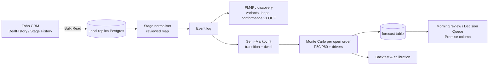
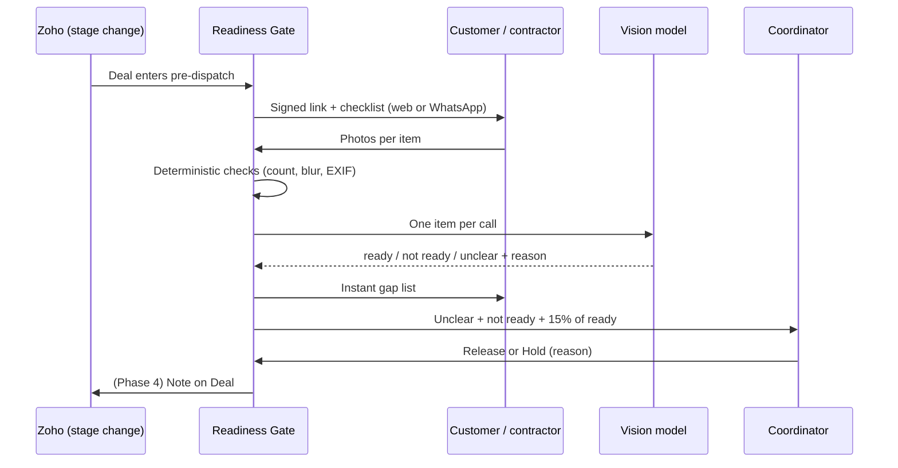
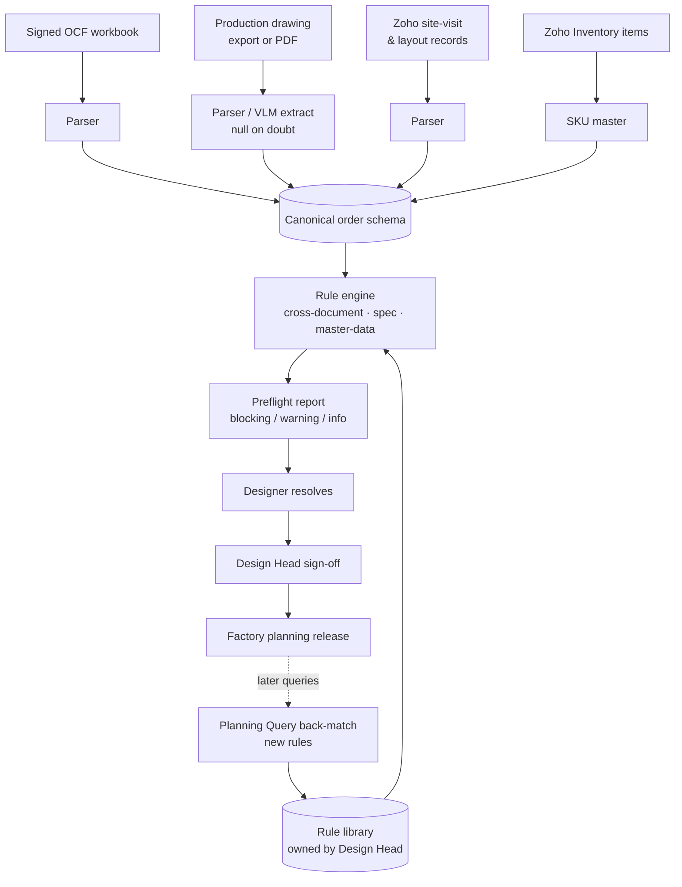
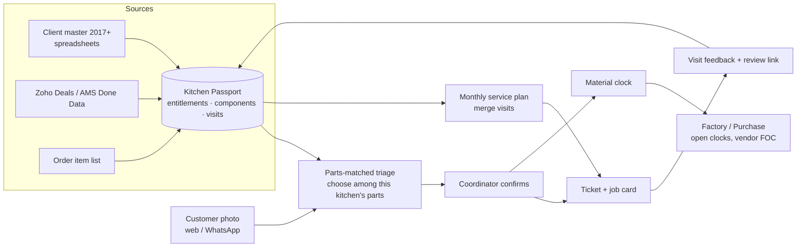

# Four builds that close Magppie's costliest handoffs

Magppie's best innovation opportunities sit in the handoffs after booking, not in lead generation or marketing. Four ideas are strong enough to build. The **Order Promise Engine** mines the order-stage history already in Zoho to give each order a calibrated handover date and to show where the days go. The **Site Readiness Gate** checks a customer's site with guided photos before measurement and dispatch, so heavy stone cabinetry does not leave the factory for a site that is not ready. The **Order Truth Check** is a three-way consistency check across the signed order form, the production drawing and the measurement record, run before anything is released to the factory. The **Kitchen Service Passport** is a per-kitchen entitlement ledger with photo complaint intake that is checked against the parts actually installed in that kitchen. Each targets a pain the company has already measured, at least partly: **308 entries into design-revision stages across 206 orders in September 2026**, **28 logged dispatch holds or slips after site approval**, **service-material lead times averaging about 65 days against 1 to 6 days to close once the material arrives**, and **about 41% achievement of planned after-sales visits** in the current month [int: PROJECT_CONTEXT.md; Dispatch Failure.xlsx; 3_SERVICE TEAM - MANUFACTURING ALIGNMENTS.xlsx; 2_SERVICE TEAM DASHBOARD.xlsx]. None of the four duplicates the Monitoring Review boards, the Flash Review, Store Standards, MAGI, the ERP blueprint, the inventory app, the Query Control Tower or the LiDAR concept. Each runs on the user's existing stack for roughly **₹0 to ₹5,000 a month** before any WhatsApp vendor fee. The recommended sequence starts with the Order Promise Engine: it costs nothing, runs locally on data the CRM replica already holds, and its findings show which of the other three will save the most days. The Site Readiness Gate should be the first build to reach production, because its results can be counted within weeks.

> **How to read this report.** Evidence labels are used throughout. **[Fact-int]** means verified in Magppie's local files. **[Fact-ext]** means verified in a cited public source. **[Research]** means a conclusion drawn from cited external evidence. **[Inference]** means the author's reasoning. **[Assumption]** means something that needs internal validation. Internal sources are cited as `[int: file]`, relative to `C:\Users\vkpal\OneDrive\Desktop\Magppie Office\`; the research team read these files but did not re-check them against live Zoho. No customer or employee personal data appears here. All money figures convert at an **assumed ₹88 per USD**, which was not verified. No baseline, saving or ROI figure here is a Magppie measurement unless it is labelled [Fact-int]. Anything labelled "illustrative" is a made-up scenario.

---

## 1. Executive summary: handoffs, not leads, are where the days go

Magppie is a vertically integrated maker and retailer: its own patented stone, its own factory at IMT Manesar, its own experience centres. It sells high-ticket kitchens. A qualified lead needs a budget of at least ₹4 lakh, list prices run from ₹7,500 to ₹9,900 per sq ft, and the company plans about 140 days from booking to handover [int: company-kb.md; Magppie_PreSales_Incentive_Policy_v2.pdf; OCF - R5 (15 Aug 26) (1).xlsx] ([magppie.com/series](https://magppie.com/series)). Zoho One Enterprise (54 seats) is the system of record. The Order Stages blueprint has **71 states and 402 transitions**, and Hold, Revision Required and Query to SM can be reached from almost every state [int: PROJECT_CONTEXT.md]. The user has already built dashboards that show where things stand today. What is missing are tools that **predict** where an order is heading, **prevent** handoff errors before they become physical, and **manage the 25-year relationship** that begins at handover.

The four selected ideas form a balanced portfolio:

| # | Idea | Portfolio slot | One-line value |
|---|------|----------------|----------------|
| 1 | **Order Promise Engine** | Prediction and decision support | A calibrated handover date and slip drivers for every order, from stage history Zoho already records |
| 2 | **Site Readiness Gate** | Physical and field process | Guided photo check-ins checked before measurement and dispatch, with a human releasing the truck |
| 3 | **Order Truth Check** | Complex internal workflow automation (the less obvious one) | A three-way match (signed order form ↔ production drawing ↔ measurement record) before factory release |
| 4 | **Kitchen Service Passport** | Customer experience and new service | An entitlement ledger, plus photo complaint intake checked against each kitchen's own parts |

**Build first:** the Order Promise Engine. It is free, runs locally on the existing replica, and gives everyone a shared map of where time is lost. **Fastest measurable value:** the Site Readiness Gate, because dispatch holds and wasted installer trips can be counted within a pilot of weeks. **Greatest long-term potential:** the Kitchen Service Passport, because the installed base under a 25-year guarantee grows every year. **Most unconventional and worth investigating:** the Order Truth Check, which borrows accounts-payable three-way matching for kitchen manufacturing.

---

## 2. Company opportunity map: seven handoffs, four already covered

The internal notes show one theme again and again: **handoff friction between departments**, tracked in WhatsApp groups and spreadsheets rather than in CRM workflows [int: CHI MEET REF 8 SEP26.xlsx; 3_SERVICE TEAM - MANUFACTURING ALIGNMENTS.xlsx]. The table maps each stage of the journey to its evidenced pain, what already covers it, and the gap that remains.

| Journey stage / department | Evidenced pain [Fact-int] | Already covered (do not duplicate) | Remaining gap |
|---|---|---|---|
| Lead → qualification (Marketing, Pre-Sales) | 12-hour first-call TAT target; PSM incentive withheld for poor CRM updates; 1,308 of 2,119 recent contacts have a blank `Client_Status` | Monitoring Review pre-sales boards, PSM health cards, lead turnaround; Zoho lead distribution; "Priya AI" sync | Capturing call content into structured fields (runner-up idea, not selected) |
| Sales ladder S1–S6 → booking (Sales) | Max 9% discount policy; AVP approval stage | Sales boards, Flash Review KRAs, incentive dashboards (empty folders) | Little that is new and high-impact |
| Pre-design → post-design (Design) | **308 revision-stage entries across 206 orders (Sept 2026)**; "Query to SM" on 82 orders; Design Head targets zero post-approval errors and 2% costing errors | Design boards, Designer MIS (planned) | **Preventing errors at release (Idea 3); predicting slip from revision loops (Idea 1)** |
| Production drawing → factory (Planning, Factory, Purchase) | Planning Query log of drawing errors: wrong quantities, dimensions, counter depth | Factory & Standup board; inventory/BOM app (colleague); ERP blueprint (colleague) | **Cross-checking the drawing against the signed order (Idea 3)** |
| Site readiness → dispatch → installation | **28 dispatch holds or slips after site approval**, often because design or installation asked to hold the vehicle; 38 of the ~140 planned days are on the customer side | Dispatch and Installation boards | **Verifying readiness before release (Idea 2)** |
| Handover → AMS / service (Customer care) | ~41% visit achievement; ~65-day average material TAT; client master still keyed by hand since 2017; an explicit request for an "AI based / CRM based" client-service UI | AMS board (counts only); ERP AMS fields (blueprint) | **Entitlement ledger, intake, material loop (Idea 4)** |
| Cross-department accountability | August issue log had no dates or costs | **Departmental Query Control Tower mockup** | Covered; excluded |
| Stores / experience centres | 7 stores, weekly audits | **Store Standards app** | Covered; excluded |

Sources for the table: [int: PROJECT_CONTEXT.md; Planning Query.xlsx; Dispatch Failure.xlsx; OCF - R5 (15 Aug 26) (1).xlsx; 2_SERVICE TEAM DASHBOARD.xlsx; CHI MEET REF 8 SEP26.xlsx; Design Head_KPIs & KRAs.pdf; dept-query-data.js; magppie-store-standards/README.md].

**Internal-data discrepancies to resolve before building anything that depends on them.** First, the founding year: the company knowledge base says 1995 [int: MAGI/inputs/company-kb.md], trade press says the brand launched in 2000 ([IndiaRetailing](https://www.indiaretailing.com/?p=39951)), and a 2024 interview traces origins to 1976 while also citing "over two decades" ([The Interview World](https://theinterview.world/crafting-healthier-kitchens-for-spreading-wellness/)). Second, complimentary service entitlements conflict. Public sources give three per year ([NKBA](https://nkba.org/?p=696931)), 75 per kitchen ([The Interview World](https://theinterview.world/crafting-healthier-kitchens-for-spreading-wellness/)), 25 annual visits ([Design Democracy, sponsored](https://designdemocracy.in/dd-magazine/the-kitchen-is-a-health-decision-magppie-wellness-builds-it-like-one)) and 5 for Series 1 ([magppie.com/series](https://magppie.com/series)). Internally, the ERP architecture describes 3 scheduled AMS visits, and the legacy service master shows 75 committed services per client in early records [int: ERP-ARCHITECTURE.json; 2_SERVICE TEAM DASHBOARD.xlsx]. This conflict is central to Idea 4. Third, there are **two Zoho org identities**: the live org (SUNROOOF LUMINARIES PRIVATE LIMITED, shared with the Sunrooof sister brand, which every Magppie tool must filter out) and org id 60046349006, named as the target in the replica recovery document [int: PROJECT_CONTEXT.md; OFFLINE_DATA_RECOVERY.md]. Fourth, Bengaluru appears on the website but not in the Store Standards store seed. Fifth, the Red Dot award count differs between three and four across sources.

---

## 3. Research findings: cheap models, unreliable eyes, and execution as the real moat

### Competitors sell tracking and guarantees; the tier Magppie competes in barely does

India's funded interiors platforms compete on tooling and on execution promises. Livspace runs a "Trackpad" site-operations app for timelines and task progress ([App Store](https://apps.apple.com/us/app/-/id1616007808)) and markets live customer tracking ([IMDA](https://www.imda.gov.sg/resources/innovative-tech-companies-directory/livspace)). In 2019, HomeLane advertised a 45-day delivery guarantee "or we pay rent" ([Raindrops Insider](https://raindrops-insider.beehiiv.com/p/homelanes-high-end-home-design-platform-banks-on-delivery-guarantees-live-3d-visuals)). One of its project-manager job ads describes a human gate that confirms materials are on site before crews are assigned ([Weekday](https://jobs.weekday.works/project-manager-interiors-at-homelane-wkdyjldoxc)). Scale has not solved execution. Search summaries of National Consumer Helpline data put "delay in providing promised services" as the largest grievance category for HomeLane in Jan–Aug 2025, though the page itself was not directly verified ([consumerhelpline.gov.in](https://consumerhelpline.gov.in/public/dashboard/sectorcompanyNatureWise/20/2409)). Livspace's Trustpilot themes repeat months-late projects ([Trustpilot](https://pl.trustpilot.com/review/livspace.com)). Magppie's public digital presence is a chatbot, PDF catalogues and booking, with no configurator or tracking ([magppie.com](https://www.magppie.com)). Its price peers (European dealer brands) sell on heritage rather than tools. **[Research]** In the luxury tier, reliable execution and visible milestones are the differentiator that is still open, and the selected ideas target exactly that.

### Most rework starts before the shop floor

Trade evidence consistently puts the origin of rework upstream. A Woodworking Network/FDMC article says 60–70% of go-backs come from errors made before information reaches the shop. The article is older and the figure anecdotal ([Woodworking Network](https://www.woodworkingnetwork.com/magazine/fdmc-magazine/how-cut-back-go-backs)). Moraware puts the average countertop fabricator at about 10% of business tied up in rework, against a 3% target, and names measurement and CAD-entry errors as the top cause. Those are Moraware's own figures ([Moraware](https://www.moraware.com/?p=19582)). A cabinet-maker playbook says many shops still re-key orders by hand from design tools into ERP ([Feed the factory](https://wnaymg.files.cmp.optimizely.com/feed-the-factory)). Some design tools expose stable exports: Polyboard has CSV cut lists ([Wood Designer](https://wooddesigner.org/help-centre/polyboard-cutting-list-export/)) and Cabinet Vision accepts XML-based ORDX orders ([Allmoxy](https://articles.allmoxy.com/connecting-allmoxy-to-industry-partner-software)). **No vendor or case study publishes a measured before-and-after error reduction from automated design validation**, so Idea 3's benefit must be proven on Magppie's own Planning Query log.

### Vision models are triage tools, not inspectors

This finding shapes Ideas 2, 3 and 4 the most. On the MMAD industrial anomaly benchmark (ICLR 2025), the best general model, GPT-4o, averaged **74.9%**, which the authors call well below industrial requirements ([arXiv 2410.09453](https://arxiv.org/html/2410.09453v3)). A 2026 preprint found **no VLM above 75% at noticing missing parts, with Claude Sonnet 4.6 at 44.1%**, and documented an "existence bias" in which models claim removed parts are visible ([arXiv 2607.18673](https://arxiv.org/pdf/2607.18673)). Performance also drops on small objects ([IJCAI 2025](https://www.ijcai.org/proceedings/2025/212)). The same failure pattern applies to documents. Production invoice extraction at BILL prefers a null to a wrong value and sends nulls to human review ([BILL engineering](https://www.bill.com/engineering/hyper-accurate-invoice-extraction-for-supplier-payments-plus)). **[Research]** Every design below uses the same order: deterministic checks first, then the VLM classifying one item at a time with a stated reason, then human approval of any pass or fail that triggers a physical or financial action. Human overrides are logged as labelled data.

### Model cost is no longer the constraint; hosting rules and data law are

Cheap-tier models cost cents at Magppie's volumes. Claude Haiku 5.5 is $0.10 per million input tokens and $0.50 per million output, halved on batch, and Sonnet 5.5 is $2/$10 ([Anthropic pricing](https://platform.claude.com/docs/en/about-claude/pricing)). OpenAI's gpt-5-nano is $0.05/$0.40 ([OpenAI pricing](https://developers.openai.com/api/docs/pricing)). Gemini 2.5 Flash-Lite has a free tier, but **free-tier content "is used to improve Google's products"**, so customer data must not go through it ([Gemini pricing](https://ai.google.dev/gemini-api/docs/pricing)). Hosting rules matter more. **Vercel Hobby is "for personal, non-commercial use"**, so internal company systems belong on Pro at $20 a month ([Vercel pricing](https://vercel.com/pricing)). **Supabase Free pauses projects after one week of inactivity** and caps the database at 500 MB and file storage at 1 GB. Pro starts at $25 a month, and a Mumbai region exists ([Supabase pricing](https://supabase.com/pricing); [Supabase regions](https://supabase.com/docs/guides/platform/regions)). The production baseline for any staff-facing tool is therefore about **$45 (₹4,000) a month, shared across all four projects**. Whether Magppie's existing Vercel team is already on Pro is not recorded [int: PROJECT_CONTEXT.md]. The free-only constraint covers the proof of concept (local Docker) but not production.

On data law, India's DPDP Rules were notified on 13 or 14 November 2025, and most operational obligations apply from **13 May 2027** ([Bar & Bench](https://www.barandbench.com/view-point/meity-notifies-final-digital-personal-data-protection-rules-2025); [Hogan Lovells](https://www.hoganlovells.com/en/publications/indias-digital-personal-data-protection-act-2023-brought-into-force-)). Cross-border transfers are allowed unless the government restricts specific countries (Rule 15), but sources disagree on when that rule took effect ([Mondaq](https://www.mondaq.com/india/data-protection/1708164/digital-personal-data-protection-rules-2025-notified)). **[Inference]** The safe pattern is: keep data at rest in Supabase Mumbai or local Postgres; send pseudonymised payloads (record IDs, no phone numbers or addresses) to paid LLM tiers; and give purpose-specific notice for customer photos.

WhatsApp is cheap per message but unsettled. Meta has billed per delivered template since 1 July 2025, and in-window service messages are free ([Meta](https://developers.facebook.com/documentation/business-messaging/whatsapp/pricing)). India utility templates cost about ₹0.115 and marketing about ₹0.86 ([baat.ai](https://baat.ai/blog/whatsapp-api-pricing-india)). A reported change from 1 October 2026 that makes service messages chargeable is disputed and unconfirmed ([respond.io](https://respond.io/blog/whatsapp-pricing-change-2026); [Unipile](https://www.unipile.com/is-the-whatsapp-api-free/)). Magppie's own vendor shortlist quotes **₹10,000–52,000 a month for 10 numbers plus GST** [int: whatsapp vendors - ranked v2.xlsx]. Every idea below therefore starts with a signed web link and adds WhatsApp only after the vendor decision.

### AI pilots fail on workflow fit, not on models

MIT NANDA's widely reported finding that about 95% of organisations saw no measurable P&L return from GenAI blames brittle workflows and a "learning gap", not model quality. The figure comes from a preliminary study whose reported sample sizes conflict ([Fortune](https://fortune.com/2025/08/18/mit-report-95-percent-generative-ai-pilots-at-companies-failing-cfo/)). McKinsey finds that high performers are nearly 3x as likely to have fundamentally redesigned workflows; the finding is correlational ([McKinsey](https://www.mckinsey.com/capabilities/quantumblack/our-insights/the-state-of-ai-2025)). **[Inference]** This is why every selected idea changes a gate in an existing workflow (release, dispatch, intake) and reports into boards people already use, instead of standing up a separate chatbot.

---

## 4. The selected ideas

### How the shortlist was made: 23 candidates, 4 survivors

The candidates covered every department and the main technology families: speech, vision, optimisation, forecasting, process mining, retrieval and generative imaging. They were rejected if they were generic chatbots, plain dashboards, CRUD apps, ordinary CRM integrations, content generators, thin API wrappers, impractical to implement, or duplicates of existing work.

| # | Candidate | Verdict and reason |
|---|---|---|
| 1 | Order Promise Engine (stage-history process mining + time-to-handover forecast) | **Selected** |
| 2 | Site Readiness Gate (guided photo check-ins before measurement and dispatch) | **Selected** |
| 3 | Order Truth Check (signed order form ↔ drawing ↔ measurement three-way match) | **Selected** |
| 4 | Kitchen Service Passport (entitlement ledger + parts-matched intake + material loop) | **Selected** |
| 5 | Call-to-CRM capture (Hinglish speech-to-text → qualification fields) | **Runner-up.** Strong capture-once fit and ₹30–45 per audio hour transcription ([Sarvam](https://docs.sarvam.ai/api/pricing)), but no independent Hinglish benchmark exists and phone-audio error rates can be high ([Gnani.ai](https://gnani.ai/resources/research/code-switching-at-8khz)). Recording access through Ozonetel is a disabled stub, "Priya AI"'s scope is undocumented, and consent design is needed. Revisit after a 30-minute transcription bake-off |
| 6 | "Your site in Silverstone" generative renders | Rejected: a content generator next to MAGI/Higgsfield; renders can show layouts that cannot be built; brand rules on claims |
| 7 | CCTV footfall and dwell analytics in showrooms | Rejected: AI-enabled CCTV falls under DPDP ([MediaNama](https://www.medianama.com/2026/04/223-govt-ai-enabled-cctv-cameras-dpdp-rules/)); Ultralytics needs an enterprise licence for internal use ([Ultralytics](https://ultralytics.com/license)); low footfall; vendors already sell it at about ₹800 per camera per month ([Agrex](https://www.agrexai.com/footfall-analytics-india-2026-guide/)) |
| 8 | Digital Proof Lab passport / showroom check-in | Rejected: essentially a check-in CRUD app; moderate impact; better as a CRM layout change |
| 9 | Site-visit capture → design brief | Rejected: too close to the user's LiDAR/RoomPlan measurement concept |
| 10 | Auto-quotation / CPQ from module lists | Rejected as standalone: depends on the same design export as Idea 3 and is commercial CPQ territory; it becomes a later phase of Idea 3 |
| 11 | Fixed-camera vision QC at PDI | Rejected: needs controlled lighting and labelled data; VLMs score poorly on small defects; licensing issues |
| 12 | Installer crew routing (OR-Tools VRPTW) | Rejected for now: installs take several days each, crew count is unknown, and a calendar may be enough ([OR-Tools](https://developers.google.com/optimization/routing/vrptw)) |
| 13 | Inter-department handoff SLA tracker | Rejected: duplicates the Departmental Query Control Tower |
| 14 | AI-written management-review narratives | Rejected: duplicates the Flash Review and Morning review |
| 15 | ML lead scoring / next-best-action | Rejected: Zia Scores exist on Enterprise ([Zoho](https://help.zoho.com/portal/es/community/topic/introducing-zia-scoring-28-2-2023?page=1)); small data; overlaps PSM health |
| 16 | Pipeline-to-procurement material forecaster | Rejected: overlaps the inventory/BOM app and the ERP; 62% blank `Client_Status`; per-order BOMs unknown |
| 17 | Payment-milestone and collections risk | Rejected: low novelty; Zoho Books reminders likely cover it; finance owner unknown |
| 18 | Installer SOP knowledge assistant | Rejected: a generic chatbot |
| 19 | Warranty liability / field reliability (Weibull) model | Folded into Idea 4, Phase 4; data still in spreadsheets |
| 20 | Architect / US dealer spec portal (CAD/BIM library) | Rejected: content- and marketing-heavy, weakly grounded in internal data |
| 21 | Slab and panel nesting optimiser | Rejected: commercial tools are mature ([Slabwise](https://slabwise.com/guides/what-is-slabsmith-software-used-for-in-stone-fabrication)); in-house cutting unconfirmed |
| 22 | Discount-governance anomaly detection | Rejected: thin; overlaps incentive policy dashboards |
| 23 | AMS technician route planning | Folded into Idea 4, Phase 3 (AMS visits are many stops per day, which suits routing) |

---

### Idea 1: Order Promise Engine

**A. Identity.** The Order Promise Engine turns Zoho's dated stage history into a forecast handover date for each order and a ranked list of what is delaying it. Departments: Management (AVP, Founder's Office), Design, Post-Design, Factory planning, Installation. Primary users: ops heads in the Morning review, the AVP, and later customer-facing SMs. The problem: the company plans about 140 days per order (102 on Magppie's side, 38 on the customer's) [int: OCF - R5 (15 Aug 26) (1).xlsx], yet no one can say, per order, how likely that date is or which loop is consuming it. The dashboards show where an order is today, not where it will end up.

**B. Core insight.** [Fact-int] The data needed already exists and has been extracted. DealHistory holds about **28,025 dated stage entries from 24 Sept 2025 to 1 Oct 2026**, and `Opportunity_Stage_History` and `Lead_Status_History` add dated transitions. The user already uses Bulk Read to pull DealHistory in 3 requests instead of 140 [int: PROJECT_CONTEXT.md]. The problem is unsolved because Zoho stage fields are snapshots without dates. Before the rebuild, the boards showed 0 for S6 and Handover every month for exactly this reason [int: PROJECT_CONTEXT.md]. The blueprint is also cyclic, which breaks naive "average days per stage" thinking. Two things have changed: the user has built a reliable stage-history extraction and a local replica (Postgres, 881 tests) [int: MAGPPIE_CRM_Flash_Review/README.md], and open-source process mining (PM4Py) makes variant and rework analysis free ([arXiv 2409.11294](https://arxiv.org/pdf/2409.11294)). What is innovative here is specific. The engine treats each order as a path through the 71-state graph. It learns empirical transition probabilities and dwell-time distributions, including the probability of re-entering Revision Required or Hold. It then runs Monte Carlo simulation over each order's remaining path (a semi-Markov model) to produce P50 and P80 handover dates. This handles **right-censored** orders, those still in flight, which is essential when the history covers only about 12 months against a 140-day cycle, and which a simple average cannot do. A second output splits elapsed time into **Magppie-side vs customer-side** days using the order form's phase labels, so a forecast slip can be attributed fairly.

**C. How it works end to end.** *Trigger:* a nightly job plus on-demand recompute when an order changes stage. *Inputs:* DealHistory, Opportunity_Stage_History, Lead_Status_History via Bulk Read; Deal fields (series, city, store, designer team, booking date); the order form's planned phase durations as a reference model. *Processing:* (1) normalise stage names, including the CRM's own misspellings such as "Modd Board" and "Precourement" [int: PROJECT_CONTEXT.md], into a canonical map reviewed with ops; (2) build an event log (case = Deal, activity = canonical stage, timestamp); (3) PM4Py discovery of variants, rework loops and stage-to-stage delays, plus conformance against the order-form reference sequence; (4) fit transition and dwell distributions, stratified where data allows by series and region, with shrinkage toward the global distribution when cells are thin; (5) simulate 5,000 remaining paths per open order to get P50/P80 handover dates and slip drivers ("2 revision re-entries add a median of N days"); (6) backtest by replaying history as of past dates and checking whether actual handovers fell inside the predicted interval. *Automated actions:* write the forecast table; flag orders whose P80 passes the promised date. *Human approval:* none for computing. Any customer-facing date (Phase 4) needs SM approval. *Outputs:* a "Promise" column and drill-down in the existing Morning review / Decision Queue (an integration, not a new dashboard), plus a monthly "where the days went" process map. *Downstream use:* weekly intervention list for the AVP; evidence for whether Idea 2 or Idea 3 attacks the bigger loss. *Feedback:* calibration (the share of handovers before the P80 date should be about 80%) and the Brier score of the "late" flag, tracked monthly.

*Worked example (illustrative, invented numbers).* A Series 2 kitchen order booked in early August at a Mumbai store sits at the mood-board stage after two entries into Revision Required. The engine's simulations show that, among historical orders with two or more revision re-entries at this stage, the remaining path to Final Handover has a P50 of 118 days and a P80 of 146. That puts the P80 about five weeks after the order-form plan. The top driver is the revision loop, and the second is an unusually long customer-side site-readiness phase seen in orders from the same city. The order appears in the next Morning review with a "P80 late by 5 weeks; driver: revision loop" tag, and the Design Head takes it as a priority instead of discovering the slip at dispatch.

*Multi-agent design:* not justified. This is deterministic data engineering plus a statistical simulator. An LLM is optional, used only to write one sentence of explanation per flagged order from computed drivers.

**D. Technical architecture.** It is Python, because PM4Py and NumPy live there: a FastAPI service with a nightly job, reading from the local CRM replica's Postgres in Phases 1–2. It reuses the existing Monitoring Review Bulk Read code path (Node) as the extractor. The data model has `stage_map` (raw → canonical, versioned), `event_log` (deal_id, stage, entered_at, exited_at, actor_team), `transition_model` (from, to, prob, dwell_params, stratum, fitted_at), `forecast` (deal_id, p50, p80, late_flag, drivers JSON, model_version) and `backtest_runs`. There is no workflow engine beyond cron. Retrieval is not needed. Integrations: **Zoho CRM Bulk Read API — officially supported** and already in use [int: PROJECT_CONTEXT.md]; **COQL — officially supported, but the dashboard app does not hold the scope** [int: PROJECT_CONTEXT.md] ([Zoho COQL](https://www.zoho.com/crm/developer/docs/api/v8/COQL-Overview.html)); Monitoring Review consumes forecasts through an internal JSON endpoint — **possible via alternative** (it must respect that board's rule of no persistent database for private CRM data; see open questions). Auth: the existing dashboard credential, which must be re-enabled before any exposure because Monitoring Review auth is currently off [int: PROJECT_CONTEXT.md]. Every forecast row stores `model_version` and the input snapshot hash, so every number can be traced to records, which the user requires. Monitoring: a backtest calibration chart and an alert if calibration drifts by more than 10 points. Deployment: local Docker first; production either as a Vercel Pro serverless function reading a precomputed artefact or as a container. The Sunrooof exclusion filter is mandatory.

**E. Roadmap** (assumes about 50% of the user's time, the rest going to existing tools, and the AI-assisted pace shown by 65 commits in under three weeks on Monitoring Review [int: git log]).

| Phase | Scope | Effort | Dependencies / skills | Key risk |
|---|---|---|---|---|
| 1 PoC | Event log from the replica; stage map; PM4Py variants and rework loops; conformance vs order-form plan; one-page "where the days went" | 2 weeks | Replica data fresh; ops head reviews stage map | Stage map ambiguity; Hold misuse |
| 2 MVP | Semi-Markov simulator; P50/P80 per open order; backtest on 3 historical cut-off dates | 3 weeks | Python stats | Thin strata; censoring |
| 3 Pilot | Promise column in Morning review for 6 weeks; weekly calibration review with AVP | 6 weeks | Monitoring Review integration; AVP buy-in | Forecasts ignored if not trusted |
| 4 Production | Nightly job; drift alerts; SM-approved customer ETA (optional) | 3 weeks | Hosting decision; DPDP notice if dates go to customers | Over-promising to customers |

That is about **3.5 months to production**, with the PoC in 2 weeks.

**F. Impact and measurement.**

| Metric | Baseline to collect | Target (set after baseline) | Method | Owner | Evidence required |
|---|---|---|---|---|---|
| Forecast calibration | None exists; backtest gives first value | About 80% of handovers before P80 | Backtest + live tracking | User | Monthly calibration chart |
| Share of late orders flagged ≥4 weeks before promised date | Count of orders handed over after plan, last 12 months | Proposed: majority flagged early | Compare flags to actual outcomes | AVP | Flag log vs DealHistory |
| Revision re-entries per order | 308 entries / 206 orders in Sept 2026 [Fact-int] | Trend down after interventions (no target yet) | Monthly from event log | Design Head | Event-log query |
| Customer-side days | Unknown; computed in PoC | Visible per order | Order-form phase split | Installation manager | Phase attribution report |

**Benefit:** earlier intervention and fair attribution. **No time or revenue saving is claimed**; it has to be shown by comparing intervened and non-intervened late-flagged orders in the pilot.

**G. Cost and feasibility.** Development: about 14 person-weeks at 50%. Hosting: ₹0 in Phases 1–2 (local Docker); a share of Vercel Pro ($20) in production. Model usage: ₹0 (optional one-line explanations on Haiku 5.5 cost fractions of a dollar per month at $0.10/$0.50 per million tokens ([Anthropic pricing](https://platform.claude.com/docs/en/about-claude/pricing))). Licences: PM4Py is open source. Hardware: none. Maintenance: about 2 hours a month to review the stage map when the blueprint changes. **Entirely testable locally first.** Category: very low cost.

**H. Risks and failure conditions.** One year of history may be too short for late stages such as second installation and handover, so strata will be thin. Mitigation: global fallback and wide intervals. Stage hygiene is another risk: 33% of orders sit at stage "None", and Hold is reachable from everywhere [int: PROJECT_CONTEXT.md], so the model may learn bad recording habits rather than real process time. The forecast fails if nobody acts on it. *Cheapest validation experiment:* one week, local only. Build the event log from the replica, show the rework-loop map and the Magppie-side vs customer-side split to the AVP and Design Head, and ask whether it changes any decision. If not, stop.

**I. Competitive advantage and build vs buy.** Commercial process-mining suites exist, but they were not priced in this research. Zoho's Zia Prediction Builder can predict field values ([Zoho](https://www.zoho.com/agents/resources/help/conceptual-articles/zia-predictive-ai.html)), but nothing found shows it producing interval forecasts over a cyclic blueprint. Building is cheap, uses the extraction the user already has, and keeps private CRM data in-house. **Build.** The advantage is the reviewed stage map and the calibration discipline, not the algorithm.

*Key references.* PROJECT_CONTEXT.md establishes the data volumes, stage-history modules and hygiene issues. What remains uncertain is whether DealHistory records every blueprint transition or only some. The OCF workbook establishes planned phase durations; whether those plans are what customers are actually promised is uncertain. PM4Py ([arXiv 2409.11294](https://arxiv.org/pdf/2409.11294)) establishes the method. An SMB study with measured business outcomes is still missing ([SMU capstone](https://accountancy.smu.edu.sg/sites/accountancy.smu.edu.sg/files/student-projects/2024-09/G2%20FairPrice%20Group%20I.pdf) is a student project).

---

### Idea 2: Site Readiness Gate

**A. Identity.** The Site Readiness Gate is a guided photo check-in, completed by the customer or their site contractor, that is checked automatically and then released by a person before measurement and before dispatch. Departments: Post-Design (site visits), Logistics/Dispatch, Installation, Sales (customer relationship). Primary users: customers or their contractors (capture), the installation and dispatch coordinator (approval), the installation manager (exceptions). The problem: [Fact-int] **28 logged dispatches were held or slipped after site approval**, often because design or installation asked to hold the vehicle [int: Dispatch Failure.xlsx]. The order form allots about 38 days to customer-side work [int: OCF - R5 (15 Aug 26) (1).xlsx]. Today, site approval is a human judgement made with whatever photos turn up in a WhatsApp group.

**B. Core insight.** Stone cabinetry is heavy and hard to modify on site, so a wrong readiness call costs a truck, a crew day and a customer's trust. Industry sources name site readiness as a main installation delay ([MGS Architecture](https://www.mgsarchitecture.in/building-materials-products/kitchens/2352-ultrafresh-is-emerging-as-a-national-player-in-the-kitchen-segment.html)). Even HomeLane runs it as a human gate ([Weekday](https://jobs.weekday.works/project-manager-interiors-at-homelane-wkdyjldoxc)). It is unsolved because readiness evidence is unstructured: random photos, no checklist mapped to the drawing, no timestamp or location check. What has changed is that VLMs can now give a cheap first-pass classification of each checklist item, and the research is clear about where they fail (missing parts, small objects) ([arXiv 2607.18673](https://arxiv.org/pdf/2607.18673)). The design can therefore route exactly those cases to a person. The innovation lies in three things. First, a **readiness contract per order**, generated from the order form's Phase C items and the order's electrical and plumbing drawing points. Second, **asymmetric gating**: a false "not ready" costs a review, while a false "ready" costs a truck, so the thresholds are tuned to flag. Third, human decisions are captured as labelled data, building a Magppie-specific readiness dataset that does not exist anywhere. This is not measurement: it checks the *state* of the site, not its dimensions, so it does not overlap the LiDAR concept.

**C. How it works end to end.** *Trigger:* a Deal enters the pre-measurement stage, or the pre-dispatch stage (around PDI payment and dispatch planning). The trigger comes from the **Zoho CRM Notification API** (the app already holds the notifications scope) or from nightly DealHistory polling [int: PROJECT_CONTEXT.md]. *Inputs:* a checklist template for that gate (for example plaster and paint done, flooring laid, water and drain points placed, electrical points placed, window and door frames fixed, site dry and clean, lift or stair access for panels, storage space for material); the order's drawing reference images; photos and a short walk-through video captured in a mobile web app (PWA) opened from a signed, expiring link with no login. *Processing:* (1) deterministic checks, covering one photo per item, blur (Laplacian variance), exposure, EXIF timestamp after the request date, and an optional geotag within a radius of the site's city; (2) the VLM classifies **one item per call** as ready, not ready or unclear, with a mandatory reason, cropping to the region the prompt specifies; (3) a rule engine combines the results. *Automated actions:* the customer gets an instant gap list ("drain point photo unclear, please retake from 1 m"). The coordinator queue receives every not-ready or unclear item, plus a random **15% of "ready" items** as a spot check (a design choice, not a sourced figure). *Human approval:* the coordinator clicks "Release for dispatch" or "Hold, reason X". The release is the only path to dispatch planning. *Outputs:* a readiness verdict, an evidence pack and the hold reason. *Downstream:* the installation crew sees the evidence pack before travelling; the Order Promise Engine receives a dated customer-side completion event. *Feedback:* VLM vs human agreement per checklist item, monthly; hold reasons fed back into the checklist.

*Worked example (illustrative).* A Surat order reaches pre-dispatch. The customer's contractor submits 9 photos in 6 minutes. Deterministic checks pass. The VLM marks 7 items ready, the electrical-points photo as ready, and the water-point photo as unclear, because a pipe stub appears but its position cannot be judged. The coordinator opens a side-by-side view of the photo and the order's plumbing drawing, sees that the stub sits about where the sink base's back panel will be, and asks for a fix. The customer's plumber moves it within four days, and the truck leaves once, instead of arriving and being held, as in the cases logged in the Dispatch Failure sheet.

*Multi-agent design:* not justified. It is one model call per item behind deterministic checks.

**D. Technical architecture.** Next.js 15 + TypeScript PWA (the Store Standards stack, including its photo-walk pattern [int: magppie-store-standards/README.md]), with Supabase Postgres, Storage and RLS in the Mumbai region, and Vercel Pro hosting. Data model: `gate_template` (versioned checklist items, prompt, crop hint, criticality), `gate_request` (deal_id, gate_type, token_hash, expires_at, status), `capture` (request_id, item_id, storage_path, exif_ts, blur_score), `ai_verdict` (capture_id, model, verdict, reason, latency, cost), `human_decision` (request_id, decision, reason, reviewer, at) and `audit_log`. Workflow: Supabase Edge Function or Vercel route on upload; a Postgres `approvals` queue for human-in-the-loop. Models: Claude Sonnet 5.5 or an equivalent paid-tier vision model for item classification; a Haiku-class model to draft customer messages. Integrations: **Zoho CRM Notification API / DealHistory read — officially supported**; **write-back of a Note on the Deal — officially supported, but it needs write scope**, which breaks the read-only rule the user follows today, so Phase 4 needs explicit approval; **WhatsApp utility template with the link — possible via alternative**, pending the BSP choice and the disputed October 2026 pricing; **forcing a blueprint transition — unverified** whether it can be done safely from outside (avoid it; keep the gate advisory in Zoho and binding in operations). Auth: signed per-request tokens for customers; staff log in with domain-restricted Supabase Auth (as Store Standards does). Photos are kept for a fixed period. Customer phone numbers are never sent to the model; only the photo and item text. Monitoring: per-item agreement dashboard; daily cost log.

**E. Roadmap.**

| Phase | Scope | Effort | Dependencies / skills | Key risk |
|---|---|---|---|---|
| 1 PoC | Pull 40–60 historical site photos from Zoho site-picture modules [int: ZOHO_SOURCE_INVENTORY.md]; installation manager labels them; offline VLM eval per item; checklist v0 from the order form | 2 weeks | Access to attachments; 2 hours with installation manager | Too few labelled "not ready" photos |
| 2 MVP | PWA capture, deterministic checks, VLM verdicts, coordinator queue; no Zoho writes | 4 weeks | Supabase project (Free acceptable for MVP) | Customer capture friction |
| 3 Pilot | Shadow mode for 3 weeks (advisory only), then binding for one region's dispatches, 5 weeks more | 8 weeks | Installation and dispatch heads; customer notice text | Coordinators bypass the gate |
| 4 Production | All regions; WhatsApp template; Zoho Note write-back; monthly agreement report | 4 weeks | BSP decision; write-scope approval; Supabase Pro | Photo storage growth |

That is about **4.5 months to production**, with the PoC in 2 weeks.

**F. Impact and measurement.**

| Metric | Baseline to collect | Target | Method | Owner | Evidence |
|---|---|---|---|---|---|
| Dispatch holds or slips after approval per 100 dispatches | 28 logged cases [Fact-int]; the period and denominator must be established | Proposed: halve during the pilot (to confirm after baseline) | Dispatch Failure log + gate log | Logistics head | Monthly comparison, pilot vs non-pilot region |
| Installer revisit trips caused by site issues | Not tracked today; start tagging | Downward trend | Installation tags | Installation manager | Tagged trips |
| Customer-side readiness time | Unknown; order form plans about 38 days | Visible per order | Gate timestamps | User | Gate log |
| VLM–human agreement per item | None | ≥90% on "not ready" recall before relaxing the spot check | Labelled overrides | User | Agreement report |

**G. Cost and feasibility.** Development: about 18 person-weeks at 50%. Hosting: a share of Vercel Pro ($20) and Supabase Pro ($25), about ₹4,000 a month for all four projects. Supabase Free's 1 GB storage and one-week pause make it suitable only for the MVP ([Supabase pricing](https://supabase.com/pricing)). Model usage, illustrative: assume about 1,500 input tokens per photo (**an assumption; check the vendor's image-token rules**), 9 photos, 2 gates and 100 orders a month. That is about 2.7M input and 0.3M output tokens, roughly **$8 a month (about ₹700) on Sonnet 5.5** at $2/$10 per million tokens ([Anthropic pricing](https://platform.claude.com/docs/en/about-claude/pricing)). Order volume per month is **[Assumption]**. WhatsApp: about ₹0.115 per utility template ([baat.ai](https://baat.ai/blog/whatsapp-api-pricing-india)) plus the BSP fee (₹10,000–52,000 a month for 10 numbers on the internal shortlist, shared with Idea 4). Hardware: none, since customers use their own phones. Maintenance: about 3 hours a month (template tweaks, agreement review). **Testable locally first:** the whole Phase 1 eval runs offline on historical photos.

**H. Risks and failure conditions.** VLM existence bias could produce a false "ready". Mitigation: one item per prompt, crops, an explicit "what is missing?" prompt, a 15% spot check and no auto-release. Customers may not complete capture. Mitigation: SM or site-visit staff can capture on their behalf. Coordinators may treat the gate as extra work. The holds may also be caused by internal decisions rather than site state: the log says design or installation often asked to hold the vehicle, so part of the problem is internal, and the gate catches only the site-state share. *Cheapest validation experiment:* re-read all 28 Dispatch Failure rows with the installation manager (2 hours) and tag each "site not ready" vs "internal hold". If fewer than about a third are site-state, shrink the scope to a pre-measurement gate or reprioritise.

**I. Competitive advantage and build vs buy.** Livspace and HomeLane run site apps and human gates. No source showed VLM-verified readiness in production at any interiors company. Field-service suites, including any in Zoho One, were not evaluated in this research and should be checked before building. The defensible parts are Magppie's checklist tied to its own drawings and the labelled dataset. **Build, small.** Re-evaluate if Zoho One's field-service app can host a photo checklist.

*Key references.* Dispatch Failure.xlsx establishes that holds happen; their frequency per dispatch and cause split are uncertain. The HomeLane job ad establishes the industry pattern of a human gate, but it is a recruiting ad. MMAD and MissingBench establish the limits of VLMs; performance on Magppie's own site photos is uncertain and is the PoC's job. Meta and BSP pricing establish per-message cost; the October 2026 change is unresolved.

---

### Idea 3: Order Truth Check

**A. Identity.** The Order Truth Check is an automated three-way match between what the customer signed, what the designer drew and what was measured on site, run before an order is released to the factory. Departments: Design (Pre and Post), Factory Planning, Purchase, Sales. Primary users: designers (self-check before submitting), the Design Head (approval), the planning team (release). The problem: [Fact-int] the Planning Query log records production-drawing errors raised against designers, including wrong quantities, wrong dimensions and wrong counter depth [int: Planning Query.xlsx]. The Design Head's KPIs demand zero post-approval design errors and a costing error rate of 2% or less [int: Design Head_KPIs & KRAs.pdf]. In September there were 308 revision-stage entries [int: PROJECT_CONTEXT.md].

**B. Core insight.** Accounts payable has used **three-way matching** (purchase order ↔ goods receipt ↔ invoice) for decades because each document is produced by a different party and errors appear where they disagree. A kitchen order has the same structure. The Order Closure Form, with its series, modules, appliances and payment milestones, is the "PO". The production drawing or BOM is the "goods". The site measurement record is the reality check. **[Research]** Trade sources put most go-backs upstream of the shop floor ([Woodworking Network](https://www.woodworkingnetwork.com/magazine/fdmc-magazine/how-cut-back-go-backs)) and name measurement and CAD-entry errors as the top rework cause ([Moraware](https://www.moraware.com/?p=19582)). The problem stays unsolved because the three documents live in different places (an Excel order form, the design tool's output, Zoho visit and attachment modules), so no one compares them field by field. What has changed is that structured exports exist in common design tools (Polyboard CSV, Cabinet Vision XML; [Wood Designer](https://wooddesigner.org/help-centre/polyboard-cutting-list-export/), [Allmoxy](https://articles.allmoxy.com/cabinet-vision-export)), and where only PDFs exist, VLM extraction with null-on-doubt is now cheap ([BILL](https://www.bill.com/engineering/hyper-accurate-invoice-extraction-for-supplier-payments-plus)). The innovative part is **a rule library owned by the Design Head**, written as data, not code. Each rule is either a discrepancy rule between documents or a spec rule from Magppie's own product definitions. For example, Series 1 specifies 40 kg drawers and Series 2 specifies 70 kg ([magppie.com/series](https://magppie.com/series)), so a Series 2 order whose drawing lists a 40 kg runner gets flagged. The rule library becomes the company's executable design standard. This is the **least obvious** idea in the portfolio.

**C. How it works end to end.** *Trigger:* a designer submits for production drawing approval (the Deal enters the production-drawing or E/P-checking stage), or presses "Self-check" at any time. *Inputs:* (1) the signed order form workbook, whose template is structured [int: OCF - R5 (15 Aug 26) (1).xlsx]; (2) the production drawing output, either a structured export if the design tool offers one or the PDF set; (3) the measurement record from Zoho's site-visit and kitchen-layout modules [int: ZOHO_SOURCE_INVENTORY.md]; (4) the Zoho Inventory item master (3,394 items) for SKU validity [int: Magppi_inventory_new_app-main.zip]. *Processing:* parse each source into a canonical order schema (modules, dimensions, hardware SKUs with quantities, appliances with cut-outs, series, finishes). PDF fields are extracted by a VLM into a strict JSON schema, with `null` plus a page reference when unsure. Then the rule engine runs three kinds of rules. **Cross-document rules** check that the counter depth in the drawing equals the measured depth within tolerance, that the appliance list in the drawing matches the order form, and that the drawing's series equals the signed series. **Spec rules** check drawer rating against series, hinges per door height, and runners per drawer. **Master-data rules** check that every SKU exists in Zoho Inventory and is not discontinued. *Automated actions:* produce a preflight report graded blocking, warning or info, with the evidence cell or page for each finding. *Human approval:* the designer resolves or justifies each blocking item; the Design Head signs the release. The tool never edits a drawing. *Outputs:* the preflight report, the release sign-off, and a diff record of signed vs drawn. *Downstream:* planning receives a "Truth-checked" release; later, the same canonical order schema can price a quote (folded-in candidate 10) and feed the ERP's BOM tables. *Feedback:* every Planning Query raised after release is matched back to the check: was there a rule that should have caught it? New rules are added monthly.

*Worked example (illustrative).* An L-shaped Series 2 kitchen with a 600 mm hob and a tall oven unit is submitted for production drawing. The check finds three things. The BOM lists 40 kg drawer runners on four stacks, but the order form says Series 2: **blocking**. Counter depth in the drawing is 600 mm, but the site-visit record notes a 650 mm niche: **blocking**, possibly intentional, so a justification is needed. Two shutters over 900 mm tall have two hinges each, while the rule requires three: **warning**. The designer fixes the runners and hinges and justifies the depth ("customer asked for flush 600 with filler"). The Design Head signs off. All three issues match categories that appear in the Planning Query log.

*Multi-agent design:* not justified. It is one extraction model plus a deterministic rule engine. A second "verifier" model is not worth its cost while human sign-off exists.

**D. Technical architecture.** Python FastAPI service (pydantic schemas, openpyxl for the order form, a YAML or JSON rule DSL evaluated in Python), with a Next.js review UI. Data: Supabase Mumbai or local Postgres, with tables `canonical_order` (versioned per source), `rule` (id, type, expression, severity, owner, version), `check_run`, `finding` (rule_id, severity, evidence_ref, status, justification), `release_signoff` and `planning_query_link`. Models: Sonnet 5.5-class for PDF and drawing extraction with nulls; none for rules. Retrieval: none at first. Later, embedding past findings with text-embedding-3-small at $0.02 per million tokens ([OpenAI pricing](https://developers.openai.com/api/docs/pricing)) could surface similar past errors. Integrations: **Zoho CRM record and attachment read — officially supported** within held scopes [int: PROJECT_CONTEXT.md]; **Zoho Inventory items read — officially supported** (scope held, and the inventory app already syncs) [int: Magppi_inventory_new_app-main.zip]; **design-tool structured export — unverified**, because Magppie's design software is not identified anywhere in the notes; **PDF drawing extraction — possible via alternative** (VLM, experimental, with no benchmark for technical drawings found). Auth: domain-restricted staff login; role-based sign-off. Audit: an immutable `check_run` holds input hashes. HITL: every blocking finding needs a human resolution. Deployment: local first, then Vercel Pro plus a small Python container. The Python piece could run as a Vercel Python function if within limits, which were not verified.

**E. Roadmap.**

| Phase | Scope | Effort | Dependencies / skills | Key risk |
|---|---|---|---|---|
| 0 Discovery | Identify the design tool and its exports; collect 20 past orders with their order form, drawing and measurement records, plus their Planning Queries | 1 week | Design Head, planning team | No structured export exists |
| 1 PoC | Order-form parser; 15–20 rules from Planning Query categories and series specs; **retrospective run on the 20 orders**: how many known queries would have been caught? | 3 weeks | Python | Drawings only as PDFs, with poor extraction |
| 2 MVP | Review UI, self-check button, rule DSL editable by the Design Head | 5 weeks | Next.js | Rule authoring burden |
| 3 Pilot | Advisory checks on all releases from one design team for 8 weeks | 8 weeks | Design Head sponsorship | Designers see it as policing |
| 4 Production | Binding release sign-off; Planning Query back-match; optional quote pricing from canonical schema | 4 weeks | Zoho admin, if the sign-off is mirrored as a blueprint condition | Blueprint change control |

That is about **5 to 6 months to production**. The go or no-go decision comes at week 4, from the retrospective catch rate.

**F. Impact and measurement.**

| Metric | Baseline to collect | Target | Method | Owner | Evidence |
|---|---|---|---|---|---|
| Planning Queries per 100 released orders, by category | Planning Query log rows / releases over the last 6 months (denominator to establish) | Proposed: visible decline in rule-covered categories | Back-match | Factory planning head | Monthly report |
| Retrospective catch rate | None; measured in PoC | Go/no-go: proceed if a meaningful share of past queries would have been caught | Replay | User + Design Head | PoC report |
| Post-approval design errors | Design Head KPI target is zero [Fact-int]; actual count unknown | Trend toward zero | Finding log | Design Head | KPI sheet |
| Revision-stage entries per order | 308 / 206 in Sept 2026 [Fact-int] | Secondary indicator only | Event log (Idea 1) | Design Head | Monthly |

**Benefit:** fewer factory go-backs and site rework. **No rework rate or cost is claimed**; Magppie has no remake-by-cause log yet, and the PoC should start one.

**G. Cost and feasibility.** Development: about 21 person-weeks at 50%. Hosting: shared Vercel Pro and Supabase Pro (₹4,000 a month for all four), or local-only through Phase 2. Model usage, illustrative: assume about 20k input and 3k output tokens per drawing set, for 100 orders a month. That is about $7 a month (₹600) on Sonnet 5.5 ([Anthropic pricing](https://platform.claude.com/docs/en/about-claude/pricing)), and zero if structured exports exist. Licences: none, if exports are possible within Magppie's existing design-tool licence (**[Assumption]**). Hardware: none. Maintenance: rule upkeep of about 2–4 hours a month, shared with the Design Head. **Testable locally first:** the full PoC is a retrospective replay.

**H. Risks and failure conditions.** If the design tool has no usable export and drawings are only images, extraction errors could swamp the value. Mitigation: start with order form ↔ measurement rules plus a short designer-entered "release sheet". Rules can become bureaucracy. Mitigation: warnings that do not block until precision is proven. There is also overlap risk with the colleague-led ERP BOM model and the inventory app. Mitigation: consume their item master and offer the canonical schema to them. *Cheapest validation experiment:* in two hours with the planning team, classify the last 30 Planning Query rows. Could each have been detected by comparing two documents that existed at release time? If most need judgement that no document captures, drop the idea.

**I. Competitive advantage and build vs buy.** Design-to-manufacturing suites (imos, Cabinet Vision, Microvellum) check internal consistency inside their own model ([ipros](https://www.ipros.com/en/cg1/CAM/cnc/)). No product was found that checks across a signed sales document, a CRM measurement record and the factory item master, and certainly not for stone kitchens with Magppie's series specs. **Build.** The moat is the rule library, which encodes design know-how that currently lives in people's heads.

*Key references.* Planning Query.xlsx establishes the error categories; frequency and cost are uncertain. Woodworking Network and Moraware establish that upstream errors dominate, but both are anecdotal or vendor figures. Polyboard and Cabinet Vision docs establish that exports exist in some tools; which tool Magppie uses is unknown. BILL establishes the null-on-doubt pattern; there is no benchmark for VLMs reading technical drawings.

---

### Idea 4: Kitchen Service Passport

**A. Identity.** The Kitchen Service Passport gives every installed kitchen one record: what was promised, which parts were fitted, what has been serviced, and what is waiting on material. Complaints come in by photo and are checked against that kitchen's own parts. Departments: AMS/Customer Care, Factory and Purchase (material loop), Installation (handover data), Sales and Marketing (reviews and referrals). Primary users: service coordinators, technicians, the customer care head, and customers (intake and visit booking). The problem: [Fact-int] about 41% achievement of planned AMS visits in the current month; material TAT on service complaints averaging about 65 days, with sample rows at 122–137 days, against 1–6 days to close once material arrives; client master data keyed by hand since 2017; and the service team's own explicit request for an "AI based / CRM based user interface for managing all client data and their services", including monthly service plans, feedback forms and Google review handling [int: 2_SERVICE TEAM DASHBOARD.xlsx; 3_SERVICE TEAM - MANUFACTURING ALIGNMENTS.xlsx; CHI MEET REF 8 SEP26.xlsx; 4_BACK END - SERVICE TEAM.xlsx].

**B. Core insight.** A 25-year unconditional guarantee plus complimentary services ([magppie.com](https://www.magppie.com)) creates an installed base that **grows every year whether or not sales grow**. Yet entitlements are stated inconsistently in public (5, 25, 75 or 3 a year; see Section 2), so customers probably hold different expectations from what the service team plans (**[Inference]**). The problem is unsolved because the data is split: entitlements in contracts, fitted parts in design and factory records, visits in Zoho's AMS module (4,720 records) and spreadsheets, and material status in a factory alignment sheet [int: ZOHO_SOURCE_INVENTORY.md]. What has changed is cheap vision triage and cheap WhatsApp utility messaging. The innovative part is **parts-matched triage**. Open-ended "what is broken in this photo?" is exactly where VLMs are weak ([arXiv 2410.09453](https://arxiv.org/html/2410.09453v3)). Here, the model only chooses among the components actually fitted in *this* kitchen (for example, 6 hardware SKUs from its order), which turns a recognition problem into a constrained multiple-choice one. **[Inference; no published accuracy for this exists.]** The Passport also separates likely warranty cases from misuse cases, a distinction rework research treats as its own category ([Moraware](https://www.moraware.com/?p=19582)). Its **material clock** makes the 65-day factory loop visible to the factory, not just to service.

**C. How it works end to end.** *Triggers:* (a) a customer complaint arrives by web link, WhatsApp (once a vendor is chosen) or an incoming call, where Zoho already creates a service ticket on incoming calls [int: ZOHO_AUTOMATION_INVENTORY.md]; (b) a monthly scheduler computes due service visits from handover date and entitlement; (c) Final Handover creates the Passport. *Inputs:* the client master since 2017 (dispatch, MDR, QC, handover and guarantee-booklet dates, items) [int: 4_BACK END - SERVICE TEAM.xlsx]; the Zoho Deal, AMS Done Data and the complaint blueprints (AMS/Complaint Flow and Complaint Flow – Installation, 14 states each) [int: PROJECT_CONTEXT.md]; the order's BOM or item list where available; entitlement rules per contract and series (**[Assumption]**: needs the Founder's Office to rule on the 5/25/75/3 conflict). *Processing:* (1) match the complaint to a Passport, with phone-to-order matching done server-side so the phone number never goes to the model; (2) deterministic checks (photo present, order found, entitlement status); (3) the VLM picks the most likely component and defect type from that kitchen's candidate list, or "other/unclear", with a reason; (4) rules mark it warranty, chargeable or "needs inspection". *Automated actions:* draft a ticket with the likely part pre-picked and the stock status from Zoho Inventory; merge with any scheduled AMS visit within N days; start the material clock if the part is not in stock. *Human approval:* the coordinator confirms the category, part and warranty status. Any chargeable call and any customer message beyond acknowledgements needs a person. *Outputs:* Zoho complaint record (Phase 3+), technician job card, customer acknowledgement, monthly service plan per city (an explicit service-team request). *Downstream:* the factory sees open material clocks by part and vendor; purchase sees vendor free-of-charge claim candidates (the alignment sheet tracks vendor FOC follow-up); post-visit feedback form, with review requests sent to every customer after a completed visit (design choice). *Feedback:* coordinator overrides become labels; monthly recurring-defect counts by component and install cohort, which is the seed of the warranty-reliability analysis folded in from candidate 19.

*Worked example (illustrative).* A Hyderabad customer sends a photo of a soft-close drawer that will not close. The Passport finds a Series 1 kitchen handed over in 2024 with 2 complimentary services used (entitlement shown as "pending ruling" until the policy is settled). From its 6 fitted hardware SKUs, the model proposes "drawer runner soft-close failure, 40 kg runner", with the reason that the drawer front is visibly misaligned at the closed position. The coordinator confirms. The part is in stock at the store bin, so there is no material clock. The scheduler sees a planned AMS visit to the same kitchen 9 days later and merges the two, saving a trip. The customer gets one acknowledgement with the visit date. If the part had been out of stock, the factory's open-clock list would show it on day 1 instead of day 60.

*Multi-agent design:* not justified. It is triage plus scheduling rules. A single tool-using LLM step (look up kitchen, look up stock, draft ticket) is enough.

**D. Technical architecture.** Next.js 15 + TypeScript (staff app and customer intake PWA), with Supabase Mumbai (Postgres, Storage, RLS, pg_cron for monthly plans) and Vercel Pro. Data model: `kitchen` (passport id, deal_id, handover_date, series, city), `fitted_component` (kitchen_id, sku, qty, source), `entitlement_rule` (series, contract_version, visits, cadence), `entitlement_ledger` (kitchen_id, promised, used, next_due), `complaint` (kitchen_id, photos, ai_candidate, ai_reason, human_category, warranty_flag), `material_clock` (complaint_id, sku, requested_at, received_at, vendor), `visit` (planned, done, technician_team, csat) and `audit_log`. Adopt the ERP architecture's AMS field names, using the existing AMS-vs-Service-Excel comparison [int: AMS-vs-Service-Team-Excel-Comparison.md], so the Passport can become the ERP's AMS module rather than compete with it. Models: Sonnet 5.5-class vision for triage; Haiku 5.5 for acknowledgements. Integrations: **Zoho CRM read of Deals and AMS modules — officially supported**; **creating or updating complaint records — officially supported, but it needs write scope and approval**; **Zoho Inventory stock read — officially supported** (scope held); **WhatsApp Business Platform through a BSP — possible via alternative**, pending vendor choice; **Google Business Profile review links — possible via alternative** (send a link only; no review management API was researched); **Ozonetel call context — unverified** (connector stub disabled [int: INTEGRATIONS.md]). Auth: staff domain login; customers use per-kitchen signed links. Every AI suggestion stores model, prompt version and reviewer decision. Monitoring: triage agreement rate, material-clock ageing alerts. Phase 3 can add OR-Tools routing for AMS technicians, since AMS visits are many stops per day ([OR-Tools VRPTW](https://developers.google.com/optimization/routing/vrptw)).

**E. Roadmap.**

| Phase | Scope | Effort | Dependencies / skills | Key risk |
|---|---|---|---|---|
| 1 PoC | Build the ledger for one city from the client master and AMS Done Data; reconcile promised vs given vs pending; list the entitlement conflicts for a ruling | 3 weeks | Service team sheets; Founder's Office ruling | Data too messy to match |
| 2 MVP | Intake link + parts-matched triage + coordinator queue + material clock; no Zoho writes | 6 weeks | Fitted-component data for pilot kitchens | Component lists missing for older kitchens |
| 3 Pilot | One city for 8 weeks; monthly service plan; optional AMS routing | 8 weeks | Customer care head; ERP colleague alignment | Overlap dispute with ERP AMS |
| 4 Production | All cities; WhatsApp; Zoho complaint write-back; vendor FOC report; recurring-defect and warranty reliability analysis | 6 weeks | BSP; write scope | WhatsApp cost and policy changes |

That is about **6 to 7 months to production**. The PoC alone answers the entitlement question, which is valuable in itself.

**F. Impact and measurement.**

| Metric | Baseline to collect | Target | Method | Owner | Evidence |
|---|---|---|---|---|---|
| AMS planned-visit achievement | About 41% current month; 154–212 planned per month in FY26-27 [Fact-int] | Proposed: steady increase month on month (set after 2 months) | Ledger vs visits | Customer care head | Monthly ledger |
| Service material TAT | About 65 days average [Fact-int; small sample] | Visible ageing; reduction target with factory | Material clock | Factory head + customer care head | Clock report |
| Repeat visits per complaint | Unknown | Downward trend | Complaint ↔ visit link | Customer care head | Ticket data |
| Post-visit CSAT and review volume | No CSAT data; 448+ Google reviews on the site ([magppie.com](https://www.magppie.com)) | Establish response rate first | Feedback forms | Customer care head | Form responses |
| Triage agreement | None | Measure before relying on it | Override log | User | Monthly report |

**G. Cost and feasibility.** Development: about 23 person-weeks at 50%. Hosting: shared ₹4,000 a month (Vercel Pro and Supabase Pro), with photo storage growth to watch (Pro storage quota not captured in this research). Model usage, illustrative: 300 complaints a month × 3 photos at about 1,500 tokens each (**assumption**). That is under $5 a month on Sonnet 5.5 ([Anthropic pricing](https://platform.claude.com/docs/en/about-claude/pricing)). WhatsApp is the main cost: BSP ₹10,000–52,000 a month for 10 numbers plus 18% GST [int: whatsapp vendors - ranked v2.xlsx], plus per-message fees of about ₹0.115 per utility template ([baat.ai](https://baat.ai/blog/whatsapp-api-pricing-india)). In-window replies are free under Meta's published model ([Meta](https://developers.facebook.com/documentation/business-messaging/whatsapp/pricing)), but this may change from October 2026 ([respond.io](https://respond.io/blog/whatsapp-pricing-change-2026)). The web-link intake avoids all of that during the MVP. Maintenance: about 4 hours a month. **Testable locally first:** the ledger PoC is a spreadsheet-to-Postgres reconciliation.

**H. Risks and failure conditions.** The biggest risk is organisational overlap with the colleague-led ERP's AMS design. Mitigation: present the Passport as the working implementation of the ERP's AMS tables, using its field names, and agree ownership before Phase 2. Older kitchens may lack component lists, which leaves parts matching only for newer orders. The entitlement ruling may be politically sensitive. Low visit achievement may come from customer availability or technician capacity rather than information, and the Passport solves only the information part. *Cheapest validation experiment:* one afternoon. Take 20 recent complaints from the alignment sheet and check whether the fitted component list could be found for each, and whether the material delay started on day 1 or after a hand-off gap. If the component lists are mostly unrecoverable, drop parts matching and keep the ledger and material clock.

**I. Competitive advantage and build vs buy.** Ticketing and field service are mature categories. Zoho One probably includes service-desk and field-service apps, but their fit and current use at Magppie were **not researched** and must be checked first. Use Zoho for ticket mechanics if it fits. Build only the parts no product offers: the entitlement ledger across mixed historical contracts, parts-matched triage, and the factory-facing material clock. **Hybrid: buy or reuse the ticketing, build the passport layer.**

*Key references.* The service team workbooks establish achievement, material TAT and the explicit request; sample sizes and the period covered are uncertain. Public entitlement claims establish the inconsistency; which contract terms apply to which customers is uncertain. MMAD establishes open-ended VLM weakness; the accuracy of constrained choice on Magppie photos is untested. WhatsApp pricing establishes per-message cost; October 2026 is unresolved.

---

## 5. Comparison and scoring: the cheapest idea ranks first, the deepest last

**Scoring criteria (1–10, higher is better for every row):** *Business impact* is the size of the evidenced pain times the number of departments affected. *Innovation* is how far the core mechanism goes beyond off-the-shelf products and Magppie's current tools. *Solo feasibility* is the chance one developer with the current stack reaches production without hires or hardware. *Time to MVP* scores 10 for 3 weeks or less and 1 for more than 6 months. *Initial cost* scores 10 for under ₹1k a month and 1 for over ₹50k a month; the category is shown in brackets. *Data readiness* scores 10 when data is already extracted and clean. *Automation depth* is the share of the workflow executed without manual work while keeping approvals. *Strategic value* is how much the tool becomes a foundation for later systems. *Overall priority* is a weighted sum: impact 25%, feasibility 15%, data readiness 15%, strategic value 15%, time to MVP 10%, innovation 10%, automation 5%, cost 5%.

| Criterion | 1 Order Promise Engine | 2 Site Readiness Gate | 3 Order Truth Check | 4 Kitchen Service Passport |
|---|---|---|---|---|
| Business impact | 7 | 8 | 8 | 8 |
| Innovation | 7 | 7 | 8 | 6 |
| Solo feasibility | 9 | 8 | 6 | 6 |
| Time to MVP | 9 | 8 | 5 | 6 |
| Initial cost | 10 (very low) | 8 (low) | 9 (very low) | 6 (moderate with WhatsApp) |
| Data readiness | 7 | 6 | 4 | 4 |
| Automation depth | 5 | 6 | 7 | 6 |
| Strategic value | 8 | 7 | 9 | 9 |
| **Overall priority** | **7.7** | **7.4** | **7.0** | **6.7** |

The trade-offs are sharp. The Order Promise Engine scores highest because it is nearly free and its data is already extracted. Its weakness is that it *recommends* rather than *acts*, and proving its value needs orders to complete on a 140-day cycle. The Site Readiness Gate is the opposite: modest innovation, but a physical outcome (a truck that does or does not leave) that can be counted within a pilot. The Order Truth Check has the highest ceiling, because its canonical order schema is the "capture once, reuse downstream" backbone that quoting, the ERP BOM and the inventory app could all use. But it is blocked by one unknown, the design tool's export format. The Kitchen Service Passport addresses the fastest-growing liability and an explicit internal request, but it depends most on messy spreadsheet data, an organisational agreement with the ERP owner, and the WhatsApp spend decision.

**Strongest to build first:** Order Promise Engine. **Greatest long-term potential:** Kitchen Service Passport (the installed base compounds; it is the natural home for warranty-reliability and retention work). **Fastest measurable value:** Site Readiness Gate. **Most unconventional worth investigating:** Order Truth Check (three-way matching applied to kitchen orders).

---

## 6. Recommended starting point: diagnose locally, then gate the truck

Start with **two weeks of Order Promise Engine Phase 1, run entirely locally** on the CRM replica. It costs ₹0, involves no customer-facing risk, and produces a map of where the ~140 days go, split into Magppie-side and customer-side time, with rework loops quantified. That map settles the next decision on evidence rather than intuition. If customer-side readiness and dispatch holds dominate the slip, build the Site Readiness Gate next. If design revision and post-approval errors dominate, run the Order Truth Check discovery. In parallel, have the three conversations that unblock the others: the installation manager for the 28 dispatch-failure tags, the Design Head and planning for the design-tool export question, and the customer care head with the ERP owner for the Passport overlap. **[Inference]** On current evidence, the Site Readiness Gate is the most likely first production build, because its validation needs only a 2-hour review of an existing log and its outcome can be counted. Hold the production hosting decision (Vercel Pro and Supabase Pro, about ₹4,000 a month) until a pilot is approved, and ask for that spend explicitly, with the price, as the user's free-only rule requires.

---

## 7. First 30 days

**Stakeholder conversations (weeks 1–2).** Talk to the **AVP and Founder's Office** about whether a per-order P80 date would change their weekly decisions, who rules on the service-entitlement conflict, and the hosting budget. Talk to the **Design Head and factory planning head** about which design software produces production drawings and what it can export, and to classify the last 30 Planning Queries. Talk to the **installation manager and logistics head** to tag the 28 Dispatch Failure rows as site-state vs internal hold, and to draft the readiness checklist. Talk to the **customer care head** about the entitlement rules actually applied, a 20-complaint component-traceability check, and the material loop. Talk to the **colleague who owns the ERP architecture** about how the Passport and the canonical order schema should align with the planned tables. Talk to the **Zoho admin** about COQL and write scopes, which org id is canonical, and how attachments are accessed.

**Baseline data collection (weeks 1–3).** Collect: dispatch holds per month and per dispatch, from the log plus Deal dispatch stages; Planning Queries per release over 6 months, by category; revision-stage entries per order per month, from DealHistory; AMS planned vs done per month and material TAT per complaint, from the service sheets; customer-side phase durations, once the event log exists. Record the period and denominator for every figure; several internal numbers currently lack one.

**Technical experiments (weeks 1–4).** (1) Build the event log, stage map and PM4Py variants from the replica (Promise Engine PoC). (2) Run an offline VLM readiness eval on 40–60 labelled historical site photos, one item per prompt, and report per-item agreement. (3) Parse the order-form workbook into a canonical schema and test whether one production-drawing PDF or export can be parsed with nulls. (4) Do a ledger reconciliation for one city's service records. All four run locally. Only paid-tier model APIs touch photos, with no personal fields.

**First demo (end of week 4).** In a 20-minute session in the Morning review: the "where the days went" process map with a Magppie-side vs customer-side split; a list of currently open orders whose forecast lands late, with drivers (backtest-calibrated); and the readiness eval's agreement table with three example photos. Close with one decision: which second project to pilot.

---

## 8. Open questions that change the ranking

**Which design software produces Magppie's production drawings, and can it export structured data?** If not, the Order Truth Check drops below the Passport. **Will the ERP owner accept the Passport as the AMS implementation?** If not, Idea 4 shrinks to the entitlement ledger and material clock. **Will the company fund about ₹4,000 a month for Vercel Pro and Supabase Pro, and choose a WhatsApp vendor?** Production of Ideas 2 and 4 depends on this, because Vercel Hobby is non-commercial and Supabase Free pauses. Is the existing Vercel team already on Pro? **May forecasts and photos be stored in a database at all,** given the user's rule against persisting private CRM data for Monitoring Review? That decides whether Promise Engine output lives in Supabase Mumbai, in the local replica, or only in memory. **What entitlement does each historical contract actually promise?** That sets the Passport's ledger rules. **Which Zoho org (the live Sunrooof-named org or id 60046349006) is canonical** for anything that writes back?

---

## Conclusion

Magppie's biggest leverage now lies in the moments when an order passes between departments: design to factory, factory to site, installer to service. Each of the four ideas changes one of those gates instead of adding another screen. The research changes the usual AI pitch in three ways. Model cost is now negligible at Magppie's volume, so whether a project is worth doing depends on data access and adoption, not API bills. Vision models are good enough to sort photos but not to judge them, so the useful design asks the model the narrowest possible question (one checklist item, or a choice among one kitchen's own parts) and leaves every truck, release and warranty decision to a person. And no credible public case study measures returns for any of these patterns in interiors, so Magppie's advantage will come from measuring its own baselines first. The user's habit of making every number traceable to its records is the core asset here.

The less obvious implication is that the four ideas build up one shared data asset: a dated, attributable record of each order from signature to the 25th year of service. The Promise Engine supplies the timeline, the Truth Check the canonical order, the Readiness Gate the site evidence, and the Passport the long tail. Built in that order, they give the company something its funded competitors' complaint records suggest they lack, a delivery promise backed by data.
